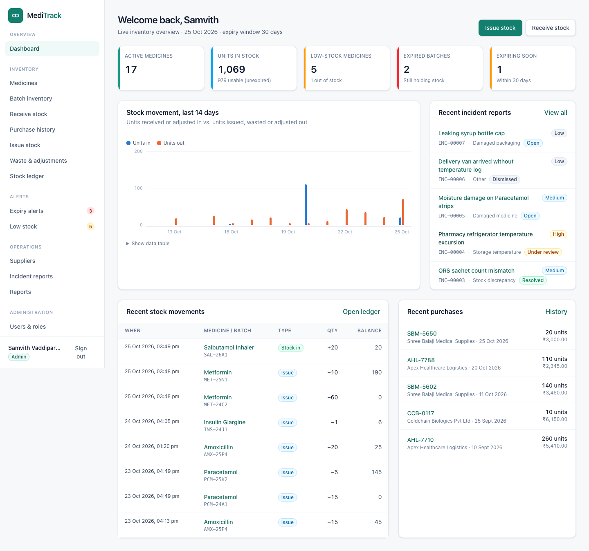
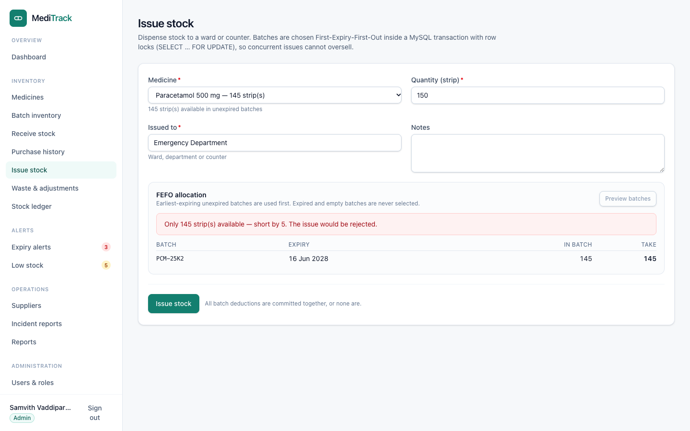
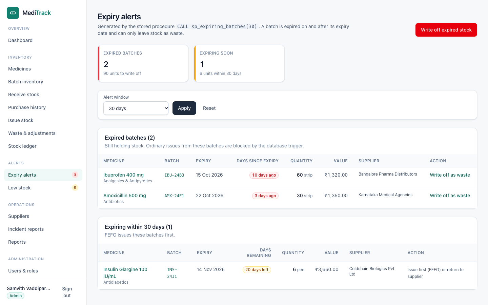
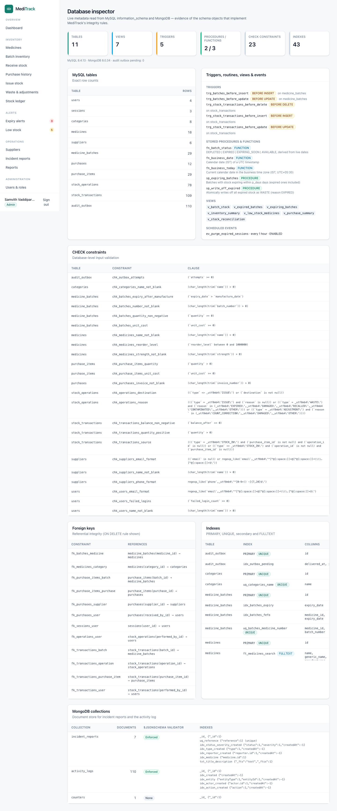

# MediTrack — Medicine Inventory & Expiry Management System

DBMS Level 3 Project · PES University

| Team member | SRN |
|---|---|
| Samvith Vaddiparthi | PES1UG24AM468 |
| Sanjit C | PES1UG24AM448 |

MediTrack is a web application for pharmacies and hospital stores that tracks
every medicine **batch** from supplier receipt to issue, enforces
**First-Expiry-First-Out (FEFO)** dispensing, blocks issues from expired
stock, raises expiry and low-stock alerts, and keeps a tamper-proof stock
ledger. Structured, transactional data lives in **MySQL 8**; flexible incident
reports and the activity/audit log live in **MongoDB**.

## Problem statement

Pharmacies hold many batches of the same medicine, each with its own expiry
date, quantity, supplier and storage needs. Paper or spreadsheet tracking lets
batches expire unnoticed, hides stock shortages, causes wastage and financial
loss, and leaves no reliable history of who moved which stock. MediTrack
replaces this with a database-enforced inventory: quantities can only change
through a validated ledger, expired stock cannot be issued, and every report is
computed from live data. Full statement: [docs/problem-statement.md](docs/problem-statement.md).

## Features

- **Authentication & roles** — secure login (bcrypt, server-side sessions,
  lockout after 5 failures); `ADMIN` and `STAFF` roles enforced on the server
  for every page, server action and API route.
- **Medicines & categories** — search (MySQL FULLTEXT), filter, sort,
  paginate; add/edit; deactivate instead of deleting records with history.
- **Batch-level inventory** — live status (Available / Expiring soon /
  Expired / Depleted) computed from the expiry date and today's date.
- **Suppliers, purchases & stock receipts** — multi-line receipts saved in one
  transaction; duplicate-submission protection; purchase history.
- **Stock issue with FEFO** — preview the allocation, issue across several
  batches atomically with row locks; expired batches are never used.
- **Waste & adjustments** — write off expired/damaged/recalled stock;
  count corrections (increases are admin-only); bulk expired write-off via a
  stored procedure.
- **Append-only stock ledger** — every movement with user, reference and the
  batch balance after the movement.
- **Expiry & low-stock alerts** — configurable window (default 30 days);
  depleted batches and waste summary.
- **Incident reports (MongoDB)** — damaged medicine/packaging, discrepancies,
  temperature excursions with type-specific metadata, review workflow and
  timeline; MongoDB aggregation statistics.
- **Activity/audit log (MongoDB)** — delivered through a transactional outbox
  so no event is lost.
- **Reports & dashboard** — all figures from real SQL/MongoDB queries.
- **Database inspector** (admin) — live list of tables, constraints, indexes,
  triggers, views, routines and MongoDB collections.

## Technology stack

| Layer | Technology |
|---|---|
| Frontend | Next.js 16 (App Router), React 19, TypeScript, Tailwind CSS 4 |
| Backend | Next.js Server Actions + Route Handlers (`/api/*`), service layer in `src/server/services` |
| SQL database | MySQL 8.4 (InnoDB) via Prisma ORM 7 (MariaDB driver adapter) + native SQL migrations |
| NoSQL database | MongoDB 8 via the official `mongodb` Node.js driver |
| Validation | Zod 4 (server-side) + MySQL CHECK constraints/triggers + MongoDB `$jsonSchema` |
| Auth | Custom server-side sessions (random token in HttpOnly cookie, SHA-256 hash in MySQL), bcrypt |
| Tests | Vitest (unit + integration against real databases), Playwright-core smoke test |

## Repository layout

```
meditrack/
├── prisma/
│   ├── schema.prisma                 # relational model (tables, keys, indexes)
│   ├── migrations/                   # reproducible SQL: tables, CHECKs, triggers, views, procedures, event
│   └── seed.ts                       # realistic, internally consistent demo data
├── src/
│   ├── app/                          # pages (App Router), server actions, /api route handlers
│   ├── components/                   # UI components and accessible charts
│   ├── lib/                          # db/mongo clients, validation, dates, permissions, errors
│   └── server/                       # auth/session, services (all business logic), API wrapper
├── tests/unit, tests/integration     # Vitest suites
├── scripts/                          # create-user, mongo-init, capture-screenshots
├── docs/                             # documentation, diagrams, SQL demo, screenshots
└── docker-compose.yml                # optional local MySQL + MongoDB
```

## Installation

Prerequisites: **Node.js ≥ 20.19** (tested on 24), and either **Docker
Desktop** or your own **MySQL 8** + **MongoDB** (local or Atlas).

```bash
cd meditrack
npm install                 # also runs `prisma generate`
cp .env.example .env        # then replace every <placeholder>
```

### Environment configuration

All configuration comes from environment variables (see
[.env.example](.env.example)); nothing secret is in the code.

| Variable | Purpose |
|---|---|
| `DATABASE_URL` | MySQL connection string for the app database `meditrack` |
| `SHADOW_DATABASE_URL` | Prisma shadow database (only for creating new migrations) |
| `TEST_DATABASE_URL` | MySQL test database (name must end in `_test`) |
| `MONGODB_URI` / `MONGODB_DB` | MongoDB connection and database name |
| `TEST_MONGODB_DB` | MongoDB test database (must end in `_test`) |
| `EXPIRY_ALERT_DAYS` | Default expiry alert window (default 30) |
| `DEMO_ADMIN_PASSWORD` / `DEMO_STAFF_PASSWORD` | Optional passwords for seeded demo accounts |
| `MYSQL_*`, `MONGO_*` | Only used by `docker-compose.yml` |

### Database setup

**Option A — Docker (recommended):**

```bash
npm run db:up          # MySQL 8.4 on port 3307, MongoDB 8 on 27017 (creds from .env)
npm run db:migrate     # prisma migrate deploy: tables + CHECKs + triggers + views + procedures + event
npm run mongo:init     # MongoDB collections, $jsonSchema validators, indexes
npm run db:seed        # demo data
```

The container's init script creates `meditrack_test` and `meditrack_shadow`
and grants the app user rights on `meditrack%` schemas.

**Option B — your own servers:** create databases `meditrack`,
`meditrack_test` (and optionally `meditrack_shadow`) and a user with all
privileges on them. Because stored functions are created while binary logging
is on, set `log_bin_trust_function_creators=1` (or use an account with
`SUPER`/`SYSTEM_VARIABLES_ADMIN`). Make sure `event_scheduler=ON` (the MySQL
default). Then run the same `db:migrate`, `mongo:init`, `db:seed` commands.

To rebuild the demo database from scratch: `npm run db:reset` (drops and
recreates `meditrack`, then seeds — development databases only).

### Demo accounts (created safely)

`npm run db:seed` creates:

| Role | Email | Password |
|---|---|---|
| ADMIN | `admin@meditrack.local` (Samvith Vaddiparthi) | value of `DEMO_ADMIN_PASSWORD` |
| STAFF | `staff@meditrack.local` (Sanjit C) | value of `DEMO_STAFF_PASSWORD` |
| STAFF | `ravi.kumar@meditrack.local` | same as staff |

If the two variables are not set, the seed generates strong random passwords
and prints them **once** in your terminal. No password is committed anywhere.

Create any other account (password typed into a hidden prompt, stored as a
bcrypt hash):

```bash
npm run user:create -- --email asha@hospital.org --name "Asha Rao" --role ADMIN
npm run user:create -- --email asha@hospital.org --reset     # reset a password
```

## Run

```bash
npm run dev            # http://localhost:3000
# production
npm run build && npm start
```

`GET /api/health` reports whether MySQL and MongoDB are reachable.

## Test

```bash
npm run typecheck          # next typegen + tsc
npm run lint               # ESLint
npm test                   # all Vitest suites (unit + integration)
npm run test:unit
npm run test:integration   # needs the databases; rebuilds meditrack_test from the migrations
npm run screenshots        # E2E smoke test + screenshots (needs a running app, Google Chrome)
```

Results: [docs/test-report.md](docs/test-report.md).

## Documentation

| Document | Contents |
|---|---|
| [docs/problem-statement.md](docs/problem-statement.md) | Problem, objectives, scope, functional requirements |
| [docs/architecture.md](docs/architecture.md) | Architecture, request flow, MySQL vs MongoDB, security, design decisions |
| [docs/er-diagram.mmd](docs/er-diagram.mmd) | Mermaid ER diagram of the implemented schema |
| [docs/system-architecture.mmd](docs/system-architecture.mmd) | Mermaid system architecture diagram |
| [docs/relational-schema.md](docs/relational-schema.md) | Relations, keys, relationships, constraints, normalisation |
| [docs/data-dictionary.md](docs/data-dictionary.md) | Every column (MySQL) and document field (MongoDB) |
| [docs/database-concepts.md](docs/database-concepts.md) | Transactions, triggers, views, procedures, indexes, MongoDB aggregation + how to demo |
| [docs/sql-demo.sql](docs/sql-demo.sql) | Executable DDL/DML/joins/aggregates/subqueries/advanced features |
| [docs/test-report.md](docs/test-report.md) | Tests executed and results |
| [docs/demo-checklist.md](docs/demo-checklist.md) | Step-by-step evaluation demo |
| [docs/screenshots-checklist.md](docs/screenshots-checklist.md) | Screenshots (captured in `docs/screenshots/`) |
| [docs/requirements-checklist.md](docs/requirements-checklist.md) | Requirement-by-requirement audit against the rubric |
| [docs/team-contributions.md](docs/team-contributions.md) | Responsibilities of each member |

## Screenshots

| Dashboard | FEFO issue preview |
|---|---|
|  |  |
| **Expiry alerts** | **Database inspector** |
|  |  |

All 26 screenshots: [docs/screenshots/](docs/screenshots/).

## Conclusion and future enhancements

MediTrack shows how database design carries the business rules: CHECK
constraints and triggers make invalid stock states impossible, transactions
keep multi-batch operations atomic, views and a stored procedure power the
alerts, and MongoDB holds the data that is naturally document-shaped.
Possible extensions: barcode/QR scanning of batches, automatic purchase
suggestions from consumption trends, multi-store transfers, e-mail/SMS alerts,
supplier return workflows, and MongoDB change streams for live dashboards.
